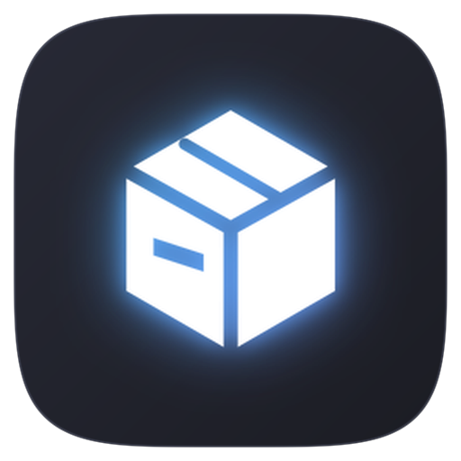

<div align="center">
  

  <h1>토라박스 (ToraBox)</h1>
  <p>대한민국 모든 택배사 지원 · 송장 자동 추측 · 물품명과 보낸이를 한곳에서 조회하는 안드로이드 앱</p>

  <p>
    <a href="https://github.com/x2tora/tora-box/releases/latest">
      
    </a>
  </p>

  <p>
    <a href="https://github.com/x2tora/tora-box/releases/latest">
      
    </a>
    <a href="https://github.com/x2tora/tora-box/releases">
      
    </a>
  </p>

  <p>
    <a href="https://github.com/x2tora/tora-box/releases">모든 릴리즈</a>
    &nbsp;·&nbsp;
    <a href="https://github.com/x2tora/tora-box/issues">이슈 제보</a>
  </p>
</div>

---

## 주요 기능

| 기능 | 설명 |
| --- | --- |
| **대한민국 전 택배사 109종 지원** | CJ대한통운, 우체국, 한진, 롯데, 로젠, 쿠팡 CLS, GS25 반값택배, CU 알뜰택배, 세븐일레븐 착한택배, 경동·대신·천일·합동·일양 화물, 당일·새벽배송 및 해외특송(EMS·차이냐오·DHL·FedEx·UPS)까지 폭넓게 지원합니다. |
| **택배사별 맞춤 배송 진행단계** | 공통 상태만 단순 표시하지 않고 각 택배사의 실제 용어(`간선상·하차`, `집중국이동`, `점포접수`, `소터분류`, `배달준비` 등)에 맞춘 전용 스텝퍼를 제공합니다. |
| **스마트 송장번호 추측 · 문자 분석** | 송장 자릿수, 프리픽스 대역, **롯데·한진 Mod-7 체크섬**, **국제등기 UPU S10 체크디지트** 및 알림톡·문자 키워드를 분석해 후보 택배사와 일치도를 추천하고 병렬 멀티 프로브로 자동 조회합니다. |
| **물품명 · 보낸이 · 기사 연락처 추출** | 택배사 직접 조회 응답에서 **물품명(품목), 수량, 보낸이(송화인), 받는이, 인수자, 배송기사 이름·연락처**를 최대한 추출해 자동으로 채워줍니다. |
| **클립보드 자동 감지 · 빠른 등록** | 복사한 송장번호나 배송 안내 문자를 앱 실행 시 자동으로 감지해 원탭으로 조회·등록하며, 하단 `+` 퀵 메뉴로 즉시 추가할 수 있습니다. |
| **보관함 · 검색 · 통계** | 물품명·보낸이·송장번호 통합 검색과 상단 고정, 보관함 분리, 누적 배송 요약 통계를 제공합니다. |
| **로컬 백업 · 인앱 업데이트** | 모든 기록을 JSON 파일이나 클립보드 텍스트로 내보내기/복원하며, GitHub Releases 최신 버전을 앱 안에서 바로 업데이트합니다. |

## 시작하기

### 1. 설치

1. 상단의 **Download for Android** 버튼 또는 [최신 릴리즈](https://github.com/x2tora/tora-box/releases/latest)에서 기기에 맞는 APK를 내려받아 설치합니다.
2. 별도의 플레이 스토어 서명이 없는 오픈소스 배포본이므로 최초 설치 시 **출처를 알 수 없는 앱 설치 허용** 안내가 나타날 수 있습니다. 허용 후 설치를 진행하세요.

| 파일 이름 | 추천 기기 |
| --- | --- |
| **`torabox-v1.0.0-arm64-v8a.apk`** | 대부분의 최신 안드로이드 스마트폰 (가장 추천) |
| `torabox-v1.0.0-armeabi-v7a.apk` | 구형 32비트 안드로이드 기기 |
| `torabox-v1.0.0-x86_64.apk` / `x86.apk` | 일부 태블릿·크롬북·에뮬레이터 |
| `torabox-v1.0.0-universal.apk` | 기기 사양을 잘 모를 때 (모든 기기 호환 통합본) |

### 2. 권장 초기 설정

1. **설정**에서 테마 모드·컬러 스타일(**기본 / Material You / 커스텀**)과 인터페이스 스타일(**기본 Miuix 바 / 리퀴드 글래스 바**)을 원하는 대로 맞춥니다.
2. **홈** 상단 입력창이나 **스마트 추측** 탭에 송장번호 또는 배송 알림 문자를 붙여넣어 추천 택배사를 확인하고 **조회 및 추가**를 눌러 등록하세요.

## 데이터 처리 및 보안

- 등록된 모든 송장번호, 물품명, 보낸이, 메모 데이터는 별도 중계 서버 없이 기기 내부 저장소에만 보관됩니다.
- 네트워크 통신은 배송 조회 시 선택한 택배사 공식 조회 서버(또는 설정된 보조 조회 엔드포인트)와 앱 내 업데이트 확인(`api.github.com`) 용도로만 사용됩니다.

## 로컬 개발 및 빌드

JDK 21 및 Android SDK(compileSdk 37 / targetSdk 36) 환경에서 빌드할 수 있습니다.

```bash
./gradlew testDebugUnitTest   # 단위 테스트 실행
./gradlew assembleDebug       # 디버그 APK 빌드
./gradlew assembleRelease     # R8 프로덕션 멀티 ABI APK 빌드
```

## 안내

ToraBox는 독립적인 오픈소스 유틸리티이며, 각 택배사의 개인정보 마스킹 정책 및 발송처 전산 등록 여부에 따라 물품명·보낸이 등 일부 상세 정보 제공 범위가 달라질 수 있습니다.
